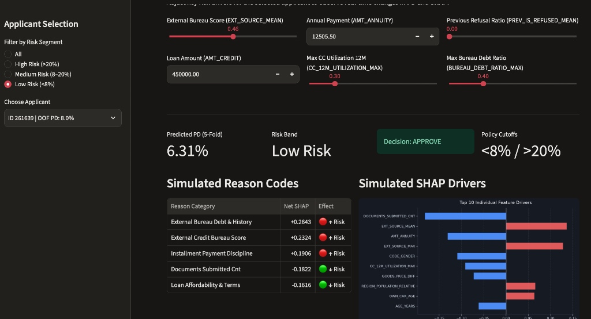
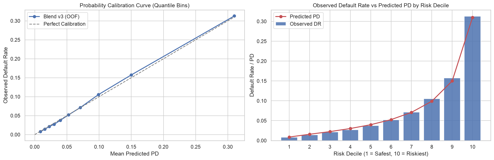
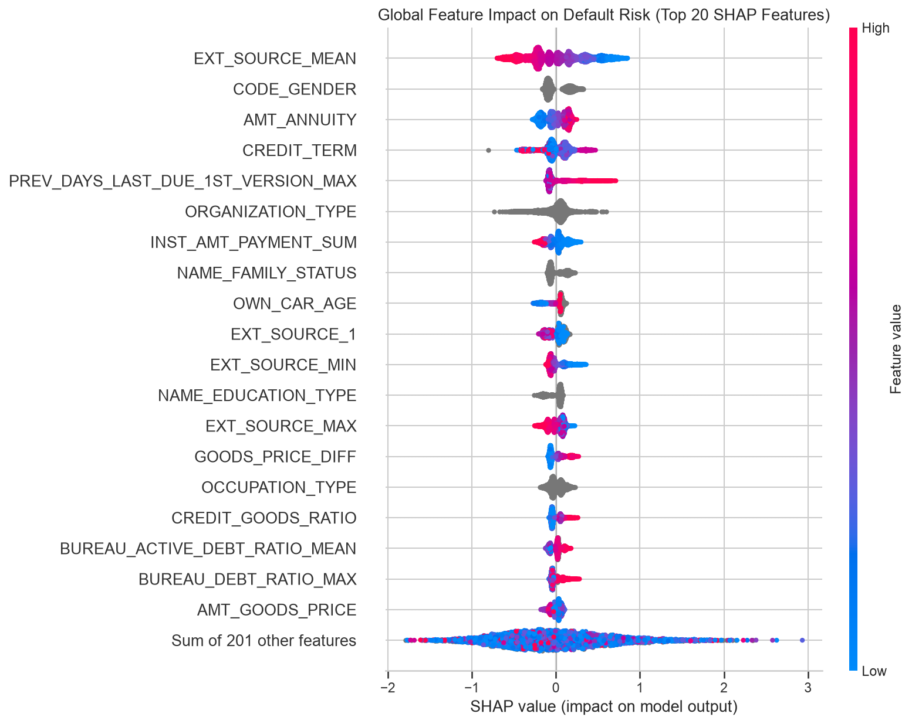
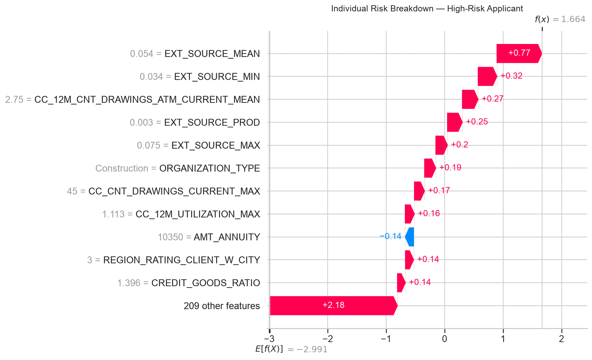

# Credit Scoring & Explainable AI (XAI)

End-to-end credit risk scoring pipeline built on the Home Credit Default Risk dataset (~307k loan applications and ~58M relational credit history records across 7 tables). The project covers relational feature engineering, 5-fold stratified validation, experiment tracking with MLflow, Optuna hyperparameter tuning, probability blending, TreeSHAP explainability with grouped Adverse Action Reason Codes, and containerized deployment via FastAPI and Streamlit.



---

## Key Results (5-Fold Stratified CV)

| Iteration | Model | ROC-AUC | Gini | KS-Stat | PR-AUC | Brier Score | Features |
| :--- | :--- | :---: | :---: | :---: | :---: | :---: | :---: |
| `v1_app_only` | Logistic Regression (`optbinning` WoE) | `0.75132` | `0.50265` | `0.37402` | `0.22988` | `0.06837` | 39 |
| `v1_app_only` | LightGBM | `0.76856` | `0.53712` | `0.40082` | `0.25347` | `0.06727` | 141 |
| `v1_app_only` | CatBoost | `0.76931` | `0.53862` | `0.40167` | `0.25405` | `0.06723` | 141 |
| `v2_relational` | Logistic Regression (`optbinning` WoE) | `0.77629` | `0.55257` | `0.41554` | `0.26161` | `0.06679` | 112 |
| `v2_relational` | LightGBM | `0.79353` | `0.58706` | `0.44395` | `0.28893` | `0.06546` | 322 |
| `v2_relational` | CatBoost | `0.79390` | `0.58781` | `0.44557` | `0.28885` | `0.06544` | 322 |
| `v2_relational` | Blend (`47.2%` LGBM + `52.8%` CatBoost) | `0.79570` | `0.59141` | `0.44824` | `0.29258` | `0.06526` | 322 |
| `v3_tuned` | LightGBM (Optuna + Gain Feature Selection) | `0.79574` | `0.59148` | `0.44888` | `0.29177` | `0.06529` | 220 |
| `v3_final` | **Blend (`63.3%` LGBM v3 + `36.7%` CatBoost v2)** | **`0.79665`** | **`0.59331`** | **`0.45014`** | **`0.29371`** | **`0.06519`** | 220 / 322 |

**Highlights:**
* **Feature engineering beat algorithm choice:** Adding relational aggregations across 6 external tables (`bureau`, `bureau_balance`, `previous_application`, `installments_payments`, `POS_CASH_balance`, `credit_card_balance`) lifted ROC-AUC by **+0.025** (+5.0 pp Gini) uniformly across all three model families. Linear WoE Logistic Regression on `v2_relational` (`0.7763`) outperformed both GBDT models trained on application data alone (`0.7686–0.7693`).
* **Anomaly handling:** Systemic `365243` date placeholders in `DAYS_EMPLOYED` and five `DAYS_*` columns of `previous_application` were flagged and replaced with `NaN` prior to aggregation.
* **Compact feature set:** Dropping 102 zero/low-gain features (`322 → 220`) combined with Optuna TPE tuning (fold-level median pruning) lifted single-model LightGBM to `0.79574` OOF ROC-AUC.

---

## Model Validation & Explainability (XAI)

### Probability Calibration & Risk Decile Lift
The final blend produces well-calibrated probabilities out of the box without post-hoc recalibration:
* **Top Decile (Riskiest 10%):** Captures **38.8%** of all portfolio defaults (**3.88x Lift**), with predicted PD `31.01%` vs. observed default rate `31.30%`.
* **Top 2 Deciles (Riskiest 20%):** Captures **58.3%** of all defaults.
* **Risk Separation:** 39x default rate spread between Decile 10 (`31.30%`) and Decile 1 (`0.80%`).



### Global & Local TreeSHAP
Global SHAP analysis confirms strong alignment with credit risk domain logic: external bureau scores (`EXT_SOURCE_MEAN`), loan terms (`CREDIT_TERM`, `CREDIT_GOODS_RATIO`), prior application timelines (`PREV_DAYS_LAST_DUE_1ST_VERSION_MAX`), installment history (`INST_AMT_PAYMENT_SUM`), external debt ratios (`BUREAU_ACTIVE_DEBT_RATIO_MEAN`), and credit card utilization/cash advances (`CC_12M_*`) dominate predictions.



For individual underwriting decisions, local SHAP values are aggregated into human-readable **Adverse Action Reason Codes** (`src/scorer.py`) so correlated derivatives (e.g., `EXT_SOURCE_MEAN`, `EXT_SOURCE_MIN`, `EXT_SOURCE_PROD`) map into a single business explanation rather than repeating the same underlying factor.



### Fairness & Regulatory Note
`CODE_GENDER` appears among the top global SHAP drivers in this benchmark dataset. While retained here for standard Kaggle benchmark comparability, protected demographic attributes must be excluded in regulated production lending environments (e.g., ECOA / EU AI Act compliance), accompanied by disparate impact testing across protected groups.

---

## Project Structure

```text
credit-scoring-xai/
├── api.py                        # FastAPI service (/health, /score/{id}, /score)
├── app.py                        # Streamlit XAI Dashboard & What-If Simulator
├── Dockerfile                    # Production container image (Python 3.11 + uv)
├── docker-compose.yml            # Multi-service orchestration (API + Dashboard)
├── pyproject.toml                # Project dependencies (managed via uv)
├── notebooks/
│   ├── 01_eda.ipynb              # Application EDA, IV ranking, anomaly audit
│   ├── 02_relational_eda.ipynb   # Risk signal audit across 6 relational tables
│   └── 03_xai_shap.ipynb         # Calibration, Decile Lift, Global & Local SHAP
├── reports/figures/              # Exported validation & XAI plots
└── src/
    ├── config.py                 # Centralized paths, CV settings, model params
    ├── data_prep.py              # Application cleaning & feature engineering (v1/v2)
    ├── features_relational.py    # Vectorized aggregations across 6 history tables
    ├── metrics.py                # ROC-AUC, Gini, KS-stat, PR-AUC, Brier Score
    ├── train.py                  # 5-fold CV trainer (LogReg, LightGBM, CatBoost + MLflow)
    ├── feature_selection.py      # 5-fold Gain importance & subset CV sweep
    ├── tune_lgbm.py              # Optuna TPE tuning with fold-level pruning
    ├── blend.py                  # OOF probability weight optimization + MLflow logging
    └── scorer.py                 # 5-fold inference & grouped SHAP Reason Codes engine


    ## Quickstart

### 1. Setup & Data
Clone the repository and install dependencies with [`uv`](https://docs.astral.sh/uv/):

```bash
git clone [https://github.com/DauletBaktibayev17/credit-scoring-xai.git](https://github.com/DauletBaktibayev17/credit-scoring-xai.git)
cd credit-scoring-xai
uv sync
```

Download the [Home Credit Default Risk](https://www.kaggle.com/competitions/home-credit-default-risk/data) CSV files into `data/raw/`.

### 2. Run the Training Pipeline

```bash
# Build v2 relational feature matrix (322 features)
python -m src.data_prep --version v2

# Train 5-fold baseline & relational models (logged to MLflow)
python -m src.train --model logreg --feature-version v2_relational
python -m src.train --model lgbm --feature-version v2_relational
python -m src.train --model catboost --feature-version v2_relational

# Run feature selection (322 -> 220), Optuna LightGBM tuning, and final OOF blend
python -m src.feature_selection
python -m src.tune_lgbm --n-trials 25
python -m src.blend --models lgbm_v3_tuned catboost_v2_relational --run-name blend_v3_final

# Inspect experiments in MLflow UI
mlflow ui --backend-store-uri sqlite:///mlflow.db
```

### 3. Launch API & Dashboard (Docker Compose)

```bash
docker compose up --build
```

* **FastAPI Swagger UI:** `http://localhost:8000/docs`
* **Streamlit XAI Dashboard:** `http://localhost:8501`

Or run locally without Docker:

```bash
uvicorn api:app --reload
streamlit run app.py
```

#### Example API Request

```bash
curl -X POST http://localhost:8000/score \
  -H "Content-Type: application/json" \
  -d '{
    "sk_id_curr": 395476,
    "overrides": {
      "EXT_SOURCE_MEAN": 0.65,
      "CC_12M_UTILIZATION_MAX": 0.20
    },
    "top_k": 5
  }'
```